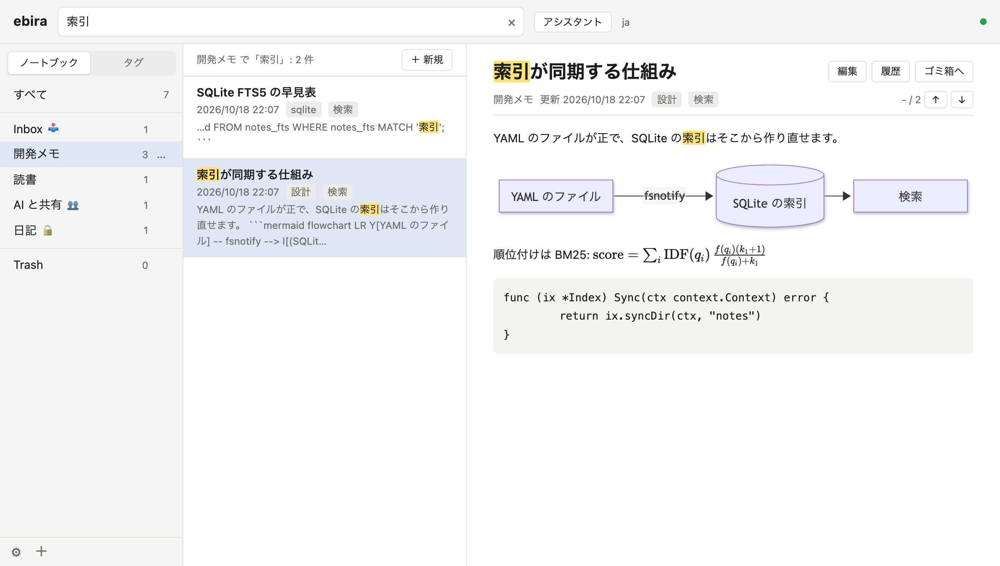
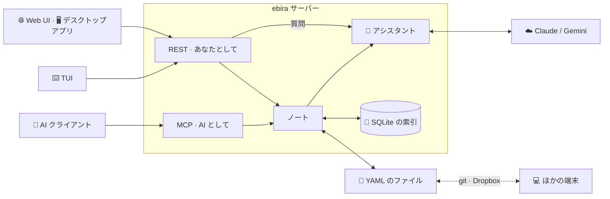
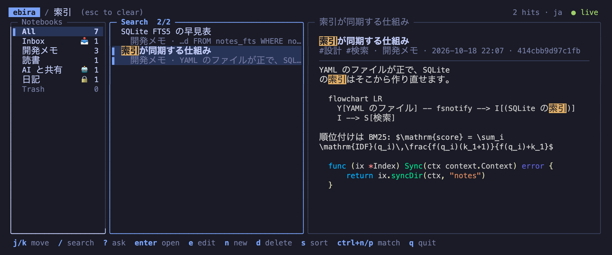

<p align="center">
  
</p>

<h1 align="center">ebira</h1>

<blockquote>
  <p>与一鏑を取つてつがひ、よつぴいてひやうど放つ。小兵といふぢやう、十二束三伏、弓は強し、鏑は浦響くほどに長鳴りして、あやまたず扇の要際一寸ばかりを射て、ひふつとぞ射切つたる。鏑は海へ入りければ、扇は空へぞ上がりける。春風に一もみ二もみもまれて、海へさつとぞ散つたりける。</p>
  <p>皆紅の扇の日出だしたるが、夕日の輝いたるに、白波の上にただよひ、浮きぬ沈みぬ揺られければ、沖には平家、舷を叩いて感じたり、陸には源氏、<strong>箙</strong>を叩いてどよめきけり。</p>
</blockquote>

<p align="center">
  <strong>ノートはただの YAML ファイル。お望みなら git で同期。<br>日本語でも英語でも探せて、AI にはあなたが決めた範囲だけ見せます。</strong>
</p>

<p align="center">
  
  <a href="LICENSE"></a>
  <a href="https://goa.design"></a>
  <a href="https://goa.design/docs/2-goa-ai/"></a>
</p>

<p align="center">
  <a href="README.md">English</a> | 日本語
</p>

---

ebira は、検索に強いノートアプリです。ノートは 1 つずつ、あなたのフォルダに置かれた YAML ファイルです。そのまま置いておくことも、Dropbox などの同期フォルダに置くことも、ebira に git で同期させることもできます。手元で動くサーバーがノートの索引を SQLite に持ち、Web UI（macOS と Windows のデスクトップアプリにもなっています）・TUI・REST API と、AI クライアント向けの MCP サーバーを提供します。

<p align="center">
  
</p>

## なぜ ebira か

ノートの置き場所には、ただのファイルが一番です。アプリより長生きしますし、git を使えば同期も履歴も手に入ります。ただ、ファイルを並べただけのフォルダは探しにくく、単語の間に空白のない日本語ではなおさらです。それに、AI にノートを読ませるなら、どのノートを読ませるかは自分で決めたいものです。

- **ファイルはあなたのもの** — 1 ノート 1 YAML ファイル。どのエディタで直しても、ebira が気づきます。
- **日本語がわかる検索** — 形態素解析で語の活用形まで見つけ、取りこぼしは bigram で拾います。
- **AI に線を引く** — ノートブックごとに、AI に何を許すかを決められます。読むだけ、書いてもよい、新しいノートを置くだけ、何もさせない、のどれかです。



## Web UI・デスクトップアプリ・TUI

同じノートを、ブラウザからも（`ebira web`）、macOS と Windows の専用のウインドウからも、ターミナルからも（`ebira`）扱えます。どれも手元の同じサーバーにつながっていて、どこでの変更もほかにすぐ反映されます。

<p align="center">
  
</p>

## 機能

- **フォルダに置く YAML のノート** — ノートのディレクトリの `<ノートブック>/<id>.yaml`。更新してもコメントや知らないキーは残ります。画像と添付ファイルはノートの隣に置きます。
- **5 つの検索方式** — `bigram`（既定）、`trigram`、`ja`（[kagome](https://github.com/ikawaha/kagome) による日本語の形態素解析と bigram）、`en`（英語の語と語幹、と trigram）、`like`。関連度の順に探すことも、一覧を並びのまま絞り込むこともできます。
- **Dropbox・iCloud Drive・git で同期** — 同期サービスの「衝突したコピー」も、2 台で直したノートも、ノートになるので、どの変更も埋もれません。
- **いつも最新** — 索引はファイルの変更に追従するので、`git pull` やほかのエディタでの変更もすぐ反映されます。索引はキャッシュなので、消しても作り直されます。
- **Web UI とデスクトップアプリ** — 数式（KaTeX）と図（Mermaid）を含む Markdown、リストの続き・コードの色付け・絵文字の補完ができるエディタ（CodeMirror 6）、マーク・タグ・サブノートブック・区切り線・アーカイブ、ドラッグ、変更の自動反映。英語と日本語、ライトとダークのテーマに対応しています。
- **TUI** — 同じノートをターミナルで、キーボードで。
- **MCP サーバーと AI 向けのノートブックの種別** — Claude Code などの AI クライアントが、ノートを検索して読み、許した場所に書けます。`default`（AI は読むだけ）、`collab`（AI も読み書きできる）、`drop`（AI はノートを置くだけ）、`private`（AI からは見えない）。
- **アシスタント** — Web UI からノートについて質問できます（Claude か Gemini）。使ったノートへのリンク付きで答えます。
- **安全な編集** — 衝突は ETag で検出し、削除したノートはまずゴミ箱へ入り、移動は元に戻せ、ノートの前の版は各端末に残ります。
- **ノートとして入っているガイド** — 新しいノートのディレクトリには ebira のガイドが入っています。これは[ドキュメント](docs/ja/README.md)そのものです。
- **バイナリ 1 つ、cgo なし**

## インストール

`ebira` コマンド（サーバー・Web UI・TUI）は macOS と Linux で動き、Go 1.27 以降が要ります:

```bash
go install github.com/ikawaha/ebira/cmd/ebira@latest
```

デスクトップアプリ（macOS 13 以降と Windows）は、サーバーを中に持っています。Windows ではこれを使います。まだ配布していないので、インストールのスクリプトがソースから作って入れます。もう一度実行すれば新しくなります。Go と git が要り、macOS では Xcode の Command Line Tools も要ります。

```bash
# macOS
curl -fsSL https://raw.githubusercontent.com/ikawaha/ebira/main/apps/desktop/install.sh | sh
```

```powershell
# Windows（PowerShell）
& ([scriptblock]::Create((irm https://raw.githubusercontent.com/ikawaha/ebira/main/apps/desktop/install-windows.ps1)))
```

リポジトリを clone して、スクリプトを読んでから実行することもできます。やり方などくわしくは [デスクトップアプリ](docs/ja/desktop.md) にあります。

## はじめかた

```bash
ebira web
```

初回は、ノートを置く場所、同期する git のリポジトリ（使う場合）、検索方式、画面の言語を聞かれ、そのあとサーバーを裏で起動して、<http://localhost:13579/> の Web UI を開きます。`ebira` なら TUI が開きます。ノートには ebira のガイドが入っているので、上から読んでください。

Claude Code につなぐには（ノートブックごとに許した範囲で）:

```bash
ebira mcp add
```

くわしくは [入れる・はじめる](docs/ja/install.md) にあります。

## ドキュメント

[ドキュメント](docs/ja/README.md)は英語と日本語で、ノートに入っているガイドと同じものです。たとえば:

- [ノートとノートブック](docs/ja/notes.md)（ノートのファイルも）
- [検索の書き方](docs/ja/search.md)
- [同期](docs/ja/sync.md)（Dropbox・iCloud Drive・git）
- [AI と使う](docs/ja/ai.md)（MCP とそのツール、AI からノートを遠ざける方法）
- [パスキー](docs/ja/passkey.md)（ebira が守れること）
- [設定](docs/ja/settings.md)と[コマンド](docs/ja/cli.md)

## ライセンス

[AGPL-3.0-or-later](LICENSE)

---

<sub>アイコンは、月岡芳年『新形三十六怪撰』の「藤原秀郷龍宮城蜈蚣を射るの図」（1890 年、パブリックドメイン）の一部です（<a href="https://commons.wikimedia.org/wiki/File:Yoshitoshi_Fujiwara_no_Hidesato.jpg">Wikimedia Commons</a>）。</sub>
