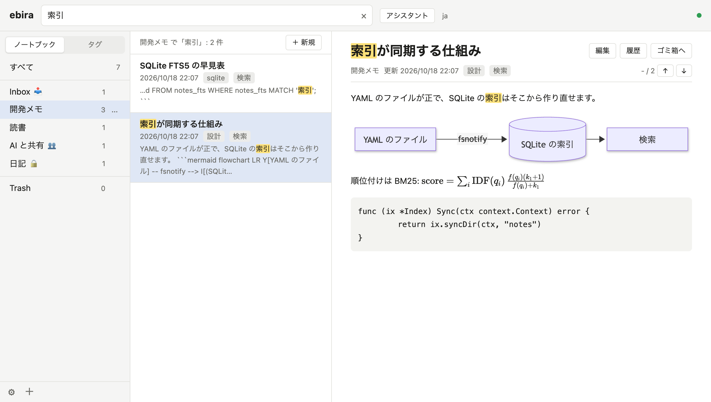
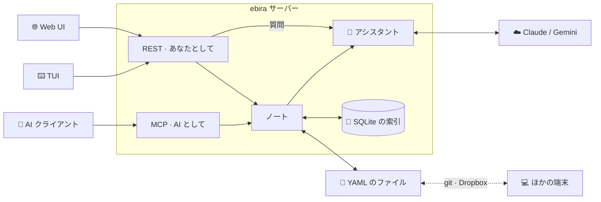
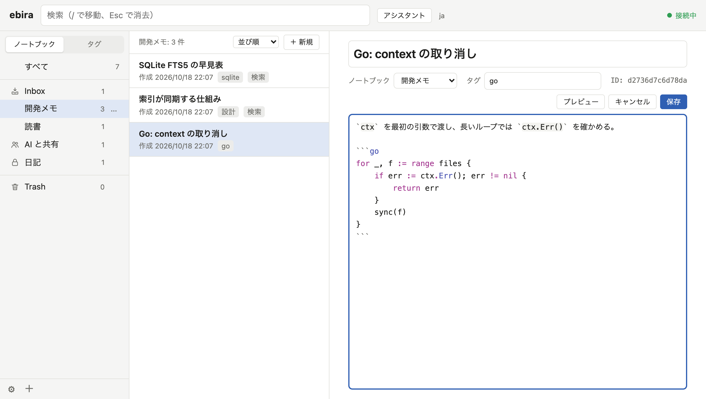
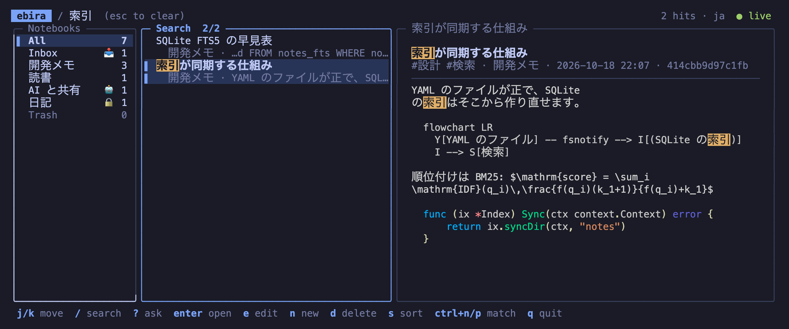

<p align="center">
  
</p>

<h1 align="center">ebira</h1>

<blockquote>
  <p>与一鏑を取つてつがひ、よつぴいてひやうど放つ。小兵といふぢやう、十二束三伏、弓は強し、鏑は浦響くほどに長鳴りして、あやまたず扇の要際一寸ばかりを射て、ひふつとぞ射切つたる。鏑は海へ入りければ、扇は空へぞ上がりける。春風に一もみ二もみもまれて、海へさつとぞ散つたりける。</p>
  <p>皆紅の扇の日出だしたるが、夕日の輝いたるに、白波の上にただよひ、浮きぬ沈みぬ揺られければ、沖には平家、舷を叩いて感じたり、陸には源氏、箙を叩いてどよめきけり。</p>
</blockquote>

<p align="center">
  <strong>ノートはただの YAML ファイル。お望みなら git で同期。<br>日本語でも英語でも探せて、AI にはあなたが決めた範囲だけ見せます。</strong>
</p>

<p align="center">
  
  <a href="LICENSE"></a>
  <a href="https://goa.design"></a>
  <a href="https://goa.design/docs/2-goa-ai/"></a>
</p>

<p align="center">
  <a href="README.md">English</a> | 日本語
</p>

---

ebira は、検索に強いノートアプリです。ノートは 1 つずつ、あなたのフォルダに置かれた YAML ファイルです。そのまま置いておくことも、Dropbox などの同期フォルダに置くことも、ebira に git で同期させることもできます。手元で動くサーバーがノートの索引を SQLite に持ち、Web UI・TUI・REST API と、AI クライアント向けの MCP サーバーを提供します。

<p align="center">
  
</p>

## なぜ ebira か

ノートの置き場所には、ただのファイルが一番です。アプリより長生きしますし、git を使えば同期も履歴も手に入ります。ただ、ファイルを並べただけのフォルダは探しにくく、単語の間に空白のない日本語ではなおさらです。それに、AI にノートを読ませるなら、どのノートを読ませるかは自分で決めたいものです。

- **ファイルはあなたのもの** — 1 ノート 1 YAML ファイル。どのエディタで直しても、ebira が気づきます。
- **日本語がわかる検索** — 形態素解析で語の活用形まで見つけ、取りこぼしは bigram で拾います。
- **AI に線を引く** — ノートブックごとに、AI に何を許すかを決められます。読むだけ、書いてもよい、新しいノートを置くだけ、何もさせない、のどれかです。



## Web UI と TUI

同じノートを、ブラウザからもターミナルからも扱えます。どちらも手元の同じサーバーにつながっていて、一方での変更はもう一方にすぐ反映されます。

**Web UI** — `ebira web`。左にノートブックとタグ、中央にノートの一覧、右にノートを表示します。ノートブックはメニューから作成・名前の変更・種別の変更・ゴミ箱への移動ができ（Trash へのドラッグでもゴミ箱へ移せます）、ゴミ箱はメニューから空にできます。ノートはノートブックへドラッグして移せます。リストの続きやコードの色付けができるエディタで Markdown を書き、画像を貼り付け、数式や図をその場で表示できます。

<p align="center">
  
</p>

**TUI** — `ebira`。同じ 3 つの欄をターミナルで、キーボードで操作します。`/` で検索、`j`/`k` で移動、`z` でノートを全幅に広げ、`e` で TUI の中か `$EDITOR` で編集します。

<p align="center">
  
</p>

## 機能

- **フォルダに置く YAML のノート** — ノートのディレクトリの `<ノートブック>/<id>.yaml`。更新してもコメントや知らないキーは残ります。画像はノートの隣に置きます。
- **5 つの検索方式** — `bigram`（既定）、`trigram`、`ja`（[kagome](https://github.com/ikawaha/kagome) による日本語の形態素解析と bigram）、`en`（英語の語と語幹、と trigram）、`like`。一致した箇所を一覧とノートで強調します。
- **Dropbox や iCloud Drive などで同期** — ノートを同期フォルダに置けます。サービスが残す「衝突したコピー」はノートになるので、どの変更も埋もれません。
- **お望みなら git で同期** — `ebira sync`、メニュー、または数分ごとに、コミット・マージ・push をまとめて行います。2 台で同じノートを直しても衝突のしるしは残らず、もう一方の版は新しいノートになります。
- **いつも最新** — 索引はファイルの変更に追従する（fsnotify）ので、`git pull` やほかのエディタでの変更もすぐ反映されます。索引はキャッシュなので、消しても作り直されます。
- **Web UI** — ノートブックとタグ、入力しながらの検索、数式（KaTeX）と図（Mermaid）を含む Markdown、リストの続き・コードの色付け・`:smile` のような絵文字の補完ができるエディタ（CodeMirror 6）、ドラッグでの並べ替えと取り込み、貼り付けでの画像の追加、変更の自動反映。英語と日本語、ライトとダークのテーマに対応しています。
- **TUI** — 同じノートをターミナルで。
- **MCP サーバー** — Claude Code などの AI クライアントが、ノートの一覧・検索・読み込みと、許した場所への書き込みをできます（[MCP サーバー](#mcp-サーバー) を参照）。
- **AI 向けのノートブックの種別** — `default`（AI は読むだけ）、`collab`（AI も読み書きできる）、`drop`（AI は新しいノートを置くだけ。既定の inbox）、`private`（AI からは見えない）。
- **アシスタント** — Web UI からノートについて質問できます。ノートを検索して読み、リンク付きで答えます。Claude か Gemini を使います。
- **取り込み** — Markdown ファイルを、front matter と画像ごと取り込めます。
- **安全な編集** — 衝突は ETag で検出し、削除したノートはまずゴミ箱へ入ります。
- **取り消しと履歴** — 保存したあとも編集の取り消しができます。ノートの移動・並べ替え・ノートブックの変更は、下に出るバーか ⌘Z / Ctrl+Z で元に戻せます。ノートの前の版は各端末に残り（ノートごとに 50 版まで。同期はしません）、履歴から戻せます。
- **バイナリ 1 つ、cgo なし**

## インストール

Go 1.27 以降が必要です。

```bash
go install github.com/ikawaha/ebira/cmd/ebira@latest
```

macOS と Linux で動きます。

## はじめかた

1. **ebira を起動します。** 初回は、ノートを置く場所、同期する git のリポジトリ（使う場合）、検索方式、Web UI と TUI の言語を聞かれ、答えは、サーバーのアドレス（`localhost:13579`）と一緒に `~/.config/ebira/config.yaml` に保存されます（MCP のクライアントに登録する URL が変わらないように）。複数の端末でノートを共有するなら、`~/Dropbox/notes` のような同期フォルダの中を答えるか、どの端末でも同じ git のリポジトリを指定します（[git で同期する](#git-で同期する)、[Dropbox や iCloud Drive で同期する](#dropbox-や-icloud-drive-で同期する) を参照）。

   ```console
   $ ebira web
   No notes found: no -notes, no notes_dir in ~/.config/ebira/config.yaml, and no notes/ in ~/work.
   Let's set up ebira.

   Directory to keep the notes in [~/notes]:
   ...
   ```

   `ebira web` はサーバーを裏で起動し、<http://localhost:13579/> の Web UI をブラウザで開きます。`ebira` なら TUI が開きます。どちらを閉じても、サーバーは動き続けます。

2. **ノートを書きます。** Web UI で（`c` で新しいノート）、またはファイルとして:

   ```yaml
   # ~/notes/inbox/weekend.yaml
   title: 週末にやること
   tags: [todo]
   created_at: 2026-10-18T10:00:00+09:00
   updated_at: 2026-10-18T10:00:00+09:00
   body: |
     - 自転車を直す
     - 新しいラーメン屋に行く
   ```

3. **Markdown を取り込みます。**

   ```bash
   ebira import -notebook reading ~/Documents/notes
   ```

4. **git で同期します。** 飛ばしてもかまいません。git を使わなければ、ノートはただのファイルで、Dropbox などの同期フォルダで共有できます。リポジトリを設定すれば、ebira は 10 分ごと、または `ebira sync` を実行したときに同期します。すでにあるノートの同期を始めるには:

   ```bash
   ebira sync -remote git@github.com:you/notes.git   # 1 回だけ。空のリポジトリか、ノートのあるリポジトリ
   echo "git_sync: 10m" >> ~/.config/ebira/config.yaml
   ```

5. **AI につなぎます。** 許したい範囲で（ほかのクライアントは [MCP サーバー](#mcp-サーバー) を参照）。Claude Code なら:

   ```bash
   claude mcp add --transport http ebira http://localhost:13579/mcp
   ```

## コマンド

| コマンド | 説明 |
| --- | --- |
| `ebira [-lang en\|ja]` | TUI を開く。サーバーが無ければ裏で起動する |
| `ebira web [-no-open]` | ブラウザで Web UI を開く。サーバーが無ければ裏で起動する |
| `ebira serve` | サーバーを前面で動かす |
| `ebira server start\|stop\|restart\|status` | 裏のサーバーを操作する。`restart` は動いていたときのフラグを引き継ぐ |
| `ebira import [-notebook ID] [-force] [-dry-run] パス...` | Markdown ファイルと、それが参照する画像をノートとして取り込む |
| `ebira files check [-delete]` | 使われていない画像と、切れた画像の参照を一覧する |
| `ebira sync [-remote URL]` | ノートを git のリポジトリと同期する（コミット、上流のブランチのマージ、push）。`-remote` で先にリポジトリにつなぐ |
| `ebira auth passkey [-no-open]` | Web UI のパスキーを、使い捨ての URL で登録する（試作。[守れること](#守れること守れないこと)） |
| `ebira auth reset [-yes]` | パスキーをすべて消し、すべてのセッションを終える（パスキーを無くしたときなど） |
| `ebira version` | `ebira` の版を出す（作ったコミットと、`ebira server status` がサーバーについて出すビルド） |

`serve` のフラグ（`server start` と `server restart` でも使えます）:

| フラグ | 既定値 | 説明 |
| --- | --- | --- |
| `-notes` | 設定ファイルの `notes_dir`、無ければ `./notes` | ノートのディレクトリ |
| `-addr` | 設定ファイルの `addr`、無ければ `localhost:13579` | 待ち受けるアドレス |
| `-search` | ノートのディレクトリの `_ebira.yaml` の `search`、無ければ `bigram` | `like`、`bigram`、`trigram`、`en`、`ja` |
| `-watch` | `true` | ノートを監視して索引を更新する |
| `-lang` | 設定ファイルの `lang`、無ければブラウザの言語 | Web UI の言語: `en` か `ja`（TUI の言語は `ebira -lang` か設定ファイルの `lang`、無ければ `$LANG`） |
| `-provider`、`-model` | API キーが設定されているプロバイダー | アシスタントのモデル: `anthropic` か `gemini` |
| `-git-sync` | 設定ファイルの `git_sync`、無ければ同期しない | 起動時と、この間隔（`10m` など）で git と同期する |
| `-auth` | 設定ファイルの `auth`、無ければ `none` | `none` か、パスキーでログインした Web UI だけをあなたとして扱う `passkey`（試作） |

どのコマンドも `-h` でフラグの一覧が出ます。

## ノートの置き方

```
~/notes/
├── _ebira.yaml              # ノートと一緒に同期する設定（検索方式など）
├── inbox/
│   └── 3f9a1c0e7b2d4a.yaml
├── development/
│   ├── _notebook.yaml       # ノートブックの表示名・並び順・種別・ノートの並べ方
│   ├── 8c21d0f4a9e3b7.yaml
│   └── 8c21d0f4a9e3b7.assets/
│       └── diagram.png
└── trash/
```

ノートのディレクトリに置くのはノートだけです。索引とサーバーの状態、ノートの前の版は、各端末の `~/.cache/ebira` と `~/.local/state/ebira` に置きます。前の版はそこの `history/` にあり、古いものは自動で消えます（上を参照）。フォルダごと消せば前の版をすべて消せ、ノートには影響しません。

- **ノートブック** はフォルダです。`inbox` と `trash` は必ずあり、ノートを削除するとまずゴミ箱へ移ります。
- **サブノートブック** は、ノートブックの中のフォルダです（1 段だけ。`development/design/` など）。種別は親のノートブックに従います。Web UI では、親のノートブックのノートの一覧の先頭に出ます。親のノートブックのメニューから作るほか、ノートブックのメニューか、ほかのノートブックの行の真ん中へのドラッグで、ノートブックをその中へ移せます。
- **ノート** は `title`、`tags`、`created_at`、`updated_at` と Markdown の `body` を持ちます。手で並べ替えると `order` が、AI が書いたノートには `created_by: ai` が付きます。
- **画像** はノートの隣の `<id>.assets/` に置き、本文からは `` で参照します。

### マーク

ノートにマークを付けると、一覧で目印になります。色（赤・橙・黄・緑・青・紫・灰）か記号（⭐ ❗ ❓ ✅ 📌 🔥 💡）から選びます。Web UI ではプレビューの旗、一覧の右クリック、`M` で、TUI では `M` を押して矢印で選びます。マークを付けてもノートの更新日時は変わりません。歯車のメニューの **マークの名前…** で、赤は「重要」のように意味を付けられます。名前はノートと一緒に `_ebira.yaml` に保存されるので、どの端末でも同じになり、`mark:重要` でそのマークのノートを探せます。今は 1 つのノートに 1 つのマークです。

## git で同期する

git を使うかは自由です。使わなくても ebira は同じように動き、ノートはただのファイルなので、好きな方法でバックアップや同期ができます。Web UI の **git と同期** は、ノートがリポジトリに入っているときだけ表示されます。

`ebira sync`、Web UI の設定メニューの **git と同期**、`-git-sync` は、どれもサーバーの中で同じことをします:

1. ノートのディレクトリの変更をコミットします（`.DS_Store` は除き、変えたファイルの一覧をメッセージに入れます）。
2. ブランチに上流のブランチがあれば、fetch してマージします。
3. push します。

リポジトリは、ebira が作る場合はノートのディレクトリそのもの（`~/notes`）です。ノートのディレクトリを含む上のリポジトリでもかまいません。同期先のリモートとブランチは git の設定のままで、ebira は今のブランチの上流のブランチと同期します。変えるときは `git remote set-url` や `git branch --set-upstream-to` を使ってください。ebira はあなたの `git` を呼ぶので、認証・SSH の鍵・Git LFS の設定がそのまま使われます。パスワードは聞かないので、裏で同期させるには credential helper か SSH agent を用意してください。

マージは衝突で止まりません。2 台で直したノートは、この端末の版を残し、もう一方の版を *Plan (conflict 2026-10-18 20:00)* のようなタイトルの新しいノートとして隣に置きます。見比べて、要らない方を消してください。ノート以外のファイルが両方で変わったときはこちらの版を、片方で消えて片方で変わったときは変わった版を残します。もう一方の版はマージのコミットに残っています。git がファイルを変えている間、ノートの書き込みは待たされ、索引はそのあと追従します。手でマージして衝突のしるしが残ったノートは、ebira が知らせ、直前の正しい内容を表示し続けます。

## Dropbox や iCloud Drive で同期する

ノートのディレクトリを、Dropbox、iCloud Drive、OneDrive、Google Drive、Syncthing などが同期するフォルダに置きます。ebira 側の設定は要りません。そこに置かれるのはノートだけで、索引とサーバーの状態は各端末に残ります。

1. **1 台目** では、初期設定で同期フォルダの中のディレクトリ（`~/Dropbox/notes` など）を答えます。同期フォルダであることが表示され、git は聞かれません。
2. **2 台目以降** では、サービスがフォルダを同期し終えるのを待ってから、同じディレクトリを答えます。ebira はノートを見つけ、検索方式などの設定をそのまま使い、その端末で索引を作ります。端末ごとにパスが違ってもかまいません。それぞれの `notes_dir` が保存されます。

同期が終わる前に 2 台目で始めると、空のノートが新しく作られ、その設定が 1 台目の設定とぶつかります。

2 台で同じノートを直すと、サービスは一方の版を残し、もう一方を `3f9a… (MacBook's conflicted copy 2026-10-18).yaml` や `3f9a… 2.yaml` のようなコピーとして残します。ebira はそうしたコピーを *Plan (conflict copy)* のようなタイトルの新しいノートにし、元のノートと同じ内容なら消します。1 台でノートを移し、別の 1 台で同じノートを直した場合は、最後に変えた方がその ID を残し、もう一方は同じようにコピーになります。新しいノートはファイルの中身だけから決まるので、2 台が同時に処理しても同じノートになります。

- 検索や索引の作成がダウンロードを待たないよう、フォルダを手元に置いたままにしてください。Dropbox は *オフラインで利用可能にする*、iCloud Drive は *ダウンロードしたままにする*、OneDrive は *このデバイス上で常に保持する* です。選択型同期を使う場合は、どの端末でもこのフォルダを含めてください。
- 同期フォルダの中では git を使わないでください。サービスがリポジトリを壊すことがあり、別の端末から同期された変更をもう一度コミットしてしまいます。初期設定でも、同期フォルダの中では git は聞かれません。どちらか一方を使ってください。

## 検索

| 方式 | しくみ | 向いているもの |
| --- | --- | --- |
| `bigram` | 文字列を 2 文字ずつ重ねて区切る | どの言語でも。2 文字以上のどんな部分文字列も見つかる |
| `trigram` | 文字列を 3 文字ずつ重ねて区切る | どの言語でも。長い語では当たる候補が絞られる。1〜2 文字の語（日本語に多い）は全部のノートをなめて探すので遅い |
| `ja` | kagome で日本語を単語に分け、動詞と形容詞を基本形にそろえる。bigram でも探す | 日本語のノート。動詞で探すと、その活用形も見つかる |
| `en` | 英語を語に分けて語幹にそろえ（Snowball の英語の stemmer）、*the* や *of* などの stop words を除く。日本語は bigram。語の一部を拾うため trigram でも探す | 英語のノート。*plan* で *plans* や *planning* も見つかり、入力の途中の語も見つかる |
| `like` | SQL の `LIKE` | ノートが少ないとき |

語は AND で探します。`"new york"` のように二重引用符で囲むとフレーズになり、語をその並びのまま探します。`tag:todo`（空白を含むなら `tag:"二つの 語"`）を足すと、そのタグのノートに絞ります。`mark:red`（マークに付けた名前でも）を足すと、そのマークのノートに絞ります。タグだけで探すと、そのタグのノートを出します。AI クライアントの `search_notes` でも同じ書き方が使えます。開いているノートの中から探すときは、プレビューの虫めがねか `f` を押します。一致に印が付き、Enter で順に移れます。一覧は変わりません。

文字列は NFKC で正規化して小文字にそろえるので、全角と半角、大文字と小文字の違いは区別しません。どの端末でも同じ方式にするには、ノートのディレクトリの `_ebira.yaml` に書きます:

```yaml
search: ja
```

## MCP サーバー

ebira は、Claude Code・Cursor・Claude Desktop などの AI クライアントに、[Model Context Protocol](https://modelcontextprotocol.io)（MCP）でノートを提供します。AI は、あなたが見せてよいとしたノートを検索して読み、書いてよいとした場所にノートを書けます。ノートの中から調べものをさせたり、AI が調べた結果をノートに残させたりできます。

### つなぎ方

MCP サーバーは ebira のサーバーの一部で、`http://localhost:13579/mcp` にあります（Streamable HTTP。アドレスは `-addr` に従います）。サーバーを動かしておいてください。`ebira web` と `ebira` は裏でサーバーを起動し、`ebira server start` でも起動できます。

Claude Code:

```bash
claude mcp add --transport http ebira http://localhost:13579/mcp
```

Cursor（`~/.cursor/mcp.json`）など、URL を指定できるクライアント:

```json
{
  "mcpServers": {
    "ebira": { "url": "http://localhost:13579/mcp" }
  }
}
```

Claude Desktop（`claude_desktop_config.json`）のように、サーバーをコマンドとして起動するクライアントでは、[mcp-remote](https://www.npmjs.com/package/mcp-remote) を間にはさみます:

```json
{
  "mcpServers": {
    "ebira": { "command": "npx", "args": ["mcp-remote", "http://localhost:13579/mcp"] }
  }
}
```

### ツール

| ツール | すること |
| --- | --- |
| `list_notebooks` | ノートブックを、種別とノートの数と一緒に一覧する |
| `list_notes` | ノートブックやタグのノートを、ページに分けて一覧する |
| `list_tags` | タグを、ノートの数と一緒に一覧する |
| `list_marks` | マークを、付けた名前と一緒に一覧する |
| `search_notes` | ノートを日本語でも英語でも検索する。結果には該当箇所の抜粋が付く |
| `get_note` | ノートを、本文と版（version）と一緒に取得する |
| `create_ai_note` | `collab` のノートブックに新しいノートを書く。`drop` のノートブックには置くだけ |
| `import_ai_note` | Markdown のファイルを、front matter と参照する画像ごと、新しいノートとして同じように取り込む |
| `add_ai_file` | `collab` のノートブックのノートに画像を足す（本文から参照する） |
| `update_ai_note` | `collab` のノートブックのノートを書き換える、またはマークを付ける。`get_note` の版が要る |
| `delete_ai_note` | `collab` のノートブックのノートをゴミ箱へ移す。`get_note` の版が要る |
| `move_ai_note` | `collab` のノートブックのノートを並べ替える（別のノートの後ろか、先頭へ） |
| `create_ai_notebook` | AI が書くための、新しい `collab` のノートブックを作る |
| `make_notebook_private` | ノートブックを AI から見えなくする。戻せるのはあなただけ |

AI からの画像は PNG・JPEG・GIF・WebP で、1 枚 5MB まで、1 つのノートに 10 枚・合わせて 20MB までです。

版があるので、AI の変更は安全です。AI が読んだあとでノートが変わっていれば、その変更は拒まれ、あなたが書いた内容は上書きされません。

### AI に許すこと

ノートブックにはそれぞれ種別があり、Web UI か TUI で設定します:

| 種別 | AI が読める | AI が書ける |
| --- | --- | --- |
| `default` | ✅ | — |
| `collab` | ✅ | ✅ 作成・更新・ゴミ箱へ移す |
| `drop` | —（名前だけ） | 新しいノートを置くだけ（ID は ebira が決める） |
| `private` | —（名前も見えない） | — |

inbox は、変えなければ `drop` です。ゴミ箱は AI からは見えません。AI が書いたノートには `created_by: ai` が付き、Web UI では ✨、TUI では ✦ が表示されます。

### 頼み方の例

つないだら、ふつうの言葉で頼めます:

- 「ebira のノートから、SQLite の索引について書いたものを探して要約して」
- 「旅行タグのノートを読んで、持ち物リストを作って」
- 「今日わかったことを『AI と共有』のノートブックにノートとして書いて」
- 「パスポートの更新を忘れないよう、inbox にメモを置いて」

### 守れること、守れないこと

- 既定ではログインはありません。サーバーは localhost（と `-addr` のホスト）宛てのリクエストだけに答え、ほかのサイトの Web ページからノートを変えるリクエストは拒みます。サーバーは手元のマシンで動かしてください。
- REST API へのリクエストはすべてあなたからのものとして扱うので、手元で `curl` を実行できる AI エージェントは、あなたとして振る舞えます。防ぐには、パスキーを求めます（試作）: `ebira auth passkey` を実行して使い捨ての URL でパスキーを登録し、設定ファイルに `auth: passkey` と書いてサーバーを起動し直します。Web UI はパスキーでのログインを求め、ログインしていない REST のリクエストは断ります。MCP は変わりません。TUI は Web UI を通してログインします。TUI に出る URL を、パスキーでログインした Web UI で開き、同じコードが出ているのを確かめて承認します（`o` で URL を開けます）。サーバーを呼ぶコマンド（`ebira sync` など）も同じようにログインします。private のノートブックを AI に見せる、ノートの履歴を見る、ゴミ箱を空にする、などの大事な操作は、ログインから 5 分を過ぎていれば、もう一度パスキーを求めます。パスキーの管理と、ほかのセッションの終了は、歯車のメニューの **パスキーの管理…** で行います。パスキーを無くしたら、`ebira auth reset` ですべて消せます。
- 種別による制限は、MCP もアシスタントも含め、ebira の API を通るすべての AI に効きます。ただ、ノートのファイルを直接読めるプログラム（ファイルを読める AI エージェントなど）は防げません。`private` は「AI に見せない」という目印で、暗号化ではありません。

## アシスタント

アシスタントは、ebira の中でノートについての質問に答えます。Web UI の「アシスタント」ボタン（TUI では `?`、API では `POST /ask`）から使います。MCP と同じ決まりでノートを検索して読み、使ったノートへのリンク付きで答えます。サーバーに `ANTHROPIC_API_KEY`（Claude）か、`GEMINI_API_KEY` または `GOOGLE_API_KEY`（Gemini）が設定されていると使えます。キーはサーバーを起動するときに渡します。たとえばパスワードマネージャーから:

```bash
op run --env-file=.env -- ebira server restart
```

## 設定

`~/.config/ebira/config.yaml` には、この端末の設定を書きます。各キーはフラグの既定値になります:

```yaml
notes_dir: ~/notes
addr: localhost:13579
lang: ja
```

キーは `notes_dir`、`addr`、`watch`、`provider`、`model`、`lang`、`theme`（`auto`・`light`・`dark`。Web UI の歯車のメニューで別のものを選べます。`light` なら TUI も明るい配色になります）、`git_sync`、`auth`（`none` か `passkey`）です。API キーは書きません。索引は `~/.cache/ebira` に、サーバーの状態とログは `~/.local/state/ebira` に置きます（XDG の環境変数に従います）。

### プレビューの見た目を変える

歯車のメニューの **スタイル…** で、組み込みのスタイル（帯・文書・コンパクト・下線）を選べます。選ぶと開いているノートで試せて、**使う** で `~/.config/ebira/preview.css` に書きます。このファイルは手直しできます。手直ししたファイルや自分で書いたファイルは、置き換える前に `preview.css.bak` に写します。

自分で `~/.config/ebira/preview.css`（設定ファイルの隣）に CSS を書くと、Web UI のプレビューのノートの本文の見た目を変えられます（Quiver のプレビューのスタイルと同じ使い方です）。ページを開くたびに読み、本文の中だけに効きます。`h1 { … }` と書いても、ページのほかの部分は変わりません。Web UI の色（`var(--accent)`、`var(--fg)`、`var(--fg-muted)` など）を使えば、ライトとダークのテーマに合わせて変わります:

```css
h1 { border-bottom: 2px solid var(--accent); color: var(--accent); }
h2 { background: var(--accent); color: #fff; border-radius: 4px; padding: 2px 8px; }
hr { border: none; border-top: 2px dotted var(--fg-muted); }
strong { color: #c0392b; }
:root[data-theme="dark"] & strong { color: #f7dc6f; }  /* メニューでダークを選んだとき */
@media (prefers-color-scheme: dark) { :root:not([data-theme="light"]) & strong { color: #f7dc6f; } }  /* システムがダークのとき */
```

CSS でノートの中身を外へ送れないように、ブラウザに何かを読みに行かせる書き方は取り除きます: `@import` と、`data:` の URL 以外の `url()` などです。端末に入っているフォントは使えますが、Web フォントは使えません。

## ライセンス

[AGPL-3.0-or-later](LICENSE)

---

<sub>アイコンは、月岡芳年『新形三十六怪撰』の「藤原秀郷龍宮城蜈蚣を射るの図」（1890 年、パブリックドメイン）の一部です（<a href="https://commons.wikimedia.org/wiki/File:Yoshitoshi_Fujiwara_no_Hidesato.jpg">Wikimedia Commons</a>）。</sub>
