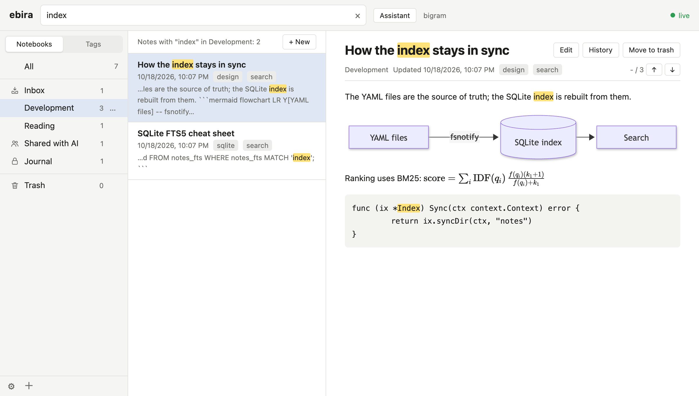
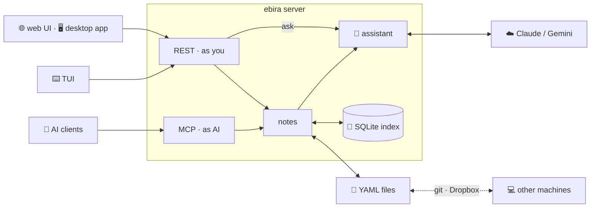
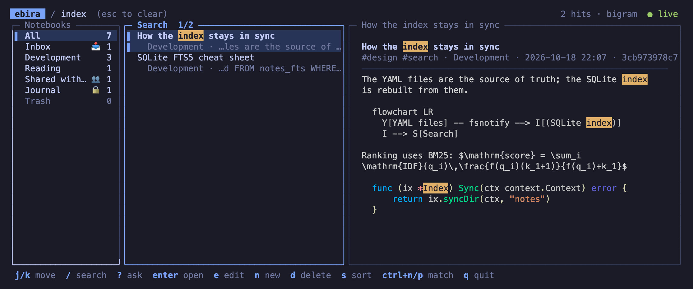

<p align="center">
  
</p>

<h1 align="center">ebira</h1>

<blockquote>
  <p title="与一鏑を取つてつがひ、よつぴいてひやうど放つ。小兵といふぢやう、十二束三伏、弓は強し、鏑は浦響くほどに長鳴りして、あやまたず扇の要際一寸ばかりを射て、ひふつとぞ射切つたる。鏑は海へ入りければ、扇は空へぞ上がりける。春風に一もみ二もみもまれて、海へさつとぞ散つたりける。">Yoichi took a humming-bulb arrow, set it to the string, drew it to the full and let it fly with a twang. Though he was a small man, the arrow was twelve hand-breadths and three fingers long and the bow was strong; the humming bulb sang out so long that it echoed across the bay, and without fail it struck the fan an inch or so from the rivet and cut it clean through. The arrow went into the sea, and the fan rose up into the sky. Tossed once, twice by the spring wind, it scattered down onto the sea.</p>
  <p title="皆紅の扇の日出だしたるが、夕日の輝いたるに、白波の上にただよひ、浮きぬ沈みぬ揺られければ、沖には平家、舷を叩いて感じたり、陸には源氏、箙を叩いてどよめきけり。">The fan, all crimson with a rising sun on it, drifted on the white waves in the glow of the setting sun, sinking and rising as it rocked. Out at sea the Heike beat on the sides of their boats in admiration; on the shore the Genji beat on their quivers, their <strong><em>ebira</em></strong>, and roared.</p>
</blockquote>

<p align="center">
  <strong>Your notes as plain YAML files, synced with git if you like.<br>Searchable in Japanese and English, and shared with your AI on your terms.</strong>
</p>

<p align="center">
  
  <a href="LICENSE"></a>
  <a href="https://goa.design"></a>
  <a href="https://goa.design/docs/2-goa-ai/"></a>
</p>

<p align="center">
  English | <a href="README.ja.md">日本語</a>
</p>

---

ebira is a note app with a strong search. Every note is a YAML file in a folder you own: keep it as it is, put it in a synced folder such as Dropbox, or let ebira sync it with git. A local server keeps a SQLite index of the notes, and serves a web UI, which also comes as a desktop app for macOS and Windows, a TUI, a REST API and an MCP server for AI clients.

<p align="center">
  
</p>

## Why

Plain files are the best home for notes: they outlive apps, and git gives you sync and history for free. But a folder of files is hard to search, especially in Japanese, where words are not separated by spaces. And when an AI can read your notes, you want to decide which ones.

- **Files you own** — one note, one YAML file. Edit them with any editor; ebira notices.
- **Search that understands Japanese** — morphological analysis finds the other forms of a word, and bigrams catch what it misses.
- **AI with boundaries** — each notebook says what an AI may do with it: read, write, only drop notes in, or nothing at all.



## Web UI, desktop app and TUI

The same notes, from the browser (`ebira web`), from a window of their own on macOS and Windows, or from the terminal (`ebira`); all talk to the same local server, and each shows the others' changes as they happen.

<p align="center">
  
</p>

## Features

- **YAML notes in folders** — `<notebook>/<id>.yaml` in your notes directory. Comments and unknown keys survive every update. Images and attached files live next to their note.
- **Five search modes** — `bigram` (default), `trigram`, `ja` (Japanese morphological analysis with [kagome](https://github.com/ikawaha/kagome), plus bigrams), `en` (English words with their stems, plus trigrams), and `like`. Search to rank, or filter a list in its own order.
- **Sync with Dropbox, iCloud Drive or git** — the conflicted copies of sync services, and notes changed on two machines, become notes, so no change is hidden.
- **Always up to date** — the index follows file changes, so `git pull` or another editor just works. The index is a cache: delete it and it is rebuilt.
- **Web UI and desktop app** — Markdown with math (KaTeX) and diagrams (Mermaid), an editor with list continuation, code coloring and emoji completion (CodeMirror 6), marks, tags, sub notebooks, separators, an archive, drag and drop, and live updates. In English and Japanese, with light and dark themes.
- **TUI** — the same notes in the terminal, driven by the keyboard.
- **MCP server and notebook kinds for AI** — AI clients such as Claude Code can search and read your notes, and write where you allow it: `default` (AI reads), `collab` (AI reads and writes), `drop` (AI only drops notes in) and `private` (invisible to AI).
- **Assistant** — ask about your notes in the web UI, with Claude or Gemini; it answers with links to the notes it used.
- **Safe edits** — conflicts are detected with ETags, deleted notes go to the trash first, moves can be undone, and earlier versions of a note are kept on each machine.
- **A guide in your notes** — a new notes directory starts with the guide of ebira, which is also [the documentation](docs/en/README.md).
- **One binary, no cgo**

## Installation

The `ebira` command, with the server, the web UI and the TUI, runs on macOS and Linux, and needs Go 1.27 or later:

```bash
go install github.com/ikawaha/ebira/cmd/ebira@latest
```

The desktop app, for macOS (13 or later) and Windows, carries the server; on Windows, it is the way to run ebira. It is not distributed yet: an install script builds it from the source and installs it, and running it again updates the app. It needs Go and git, and on macOS the Xcode Command Line Tools.

```bash
# macOS
curl -fsSL https://raw.githubusercontent.com/ikawaha/ebira/main/apps/desktop/install.sh | sh
```

```powershell
# Windows, in PowerShell
& ([scriptblock]::Create((irm https://raw.githubusercontent.com/ikawaha/ebira/main/apps/desktop/install-windows.ps1)))
```

Or clone the repository, read the script and run it there; [Desktop App](docs/en/desktop.md) tells how, and more.

## Quick Start

```bash
ebira web
```

The first time, ebira asks where to keep your notes, the git repository to sync them with (if any), how to search them and the language of the screens, then starts the server in the background and opens the web UI at <http://localhost:13579/>. `ebira` opens the TUI instead. The notes start with the guide of ebira: read it from the top.

To let Claude Code in, as far as each notebook allows:

```bash
ebira mcp add
```

More in [Installing and setting up](docs/en/install.md).

## Documentation

[The documentation](docs/en/README.md) is in English and Japanese, and is also the guide in your notes. A few places to start:

- [Notes and notebooks](docs/en/notes.md), and the files they are
- [How to search](docs/en/search.md)
- [Syncing](docs/en/sync.md) with Dropbox, iCloud Drive or git
- [Using AI](docs/en/ai.md): MCP, its tools, and keeping the notes away from AI
- [Passkeys](docs/en/passkey.md), and what ebira guards
- [Settings](docs/en/settings.md) and [Commands](docs/en/cli.md)

## License

[AGPL-3.0-or-later](LICENSE)

---

<sub>The icon is a detail of <i>Fujiwara no Hidesato Shooting the Giant Centipede at the Dragon King's Palace</i> (1890) by Tsukioka Yoshitoshi, in the public domain (<a href="https://commons.wikimedia.org/wiki/File:Yoshitoshi_Fujiwara_no_Hidesato.jpg">Wikimedia Commons</a>).</sub>
