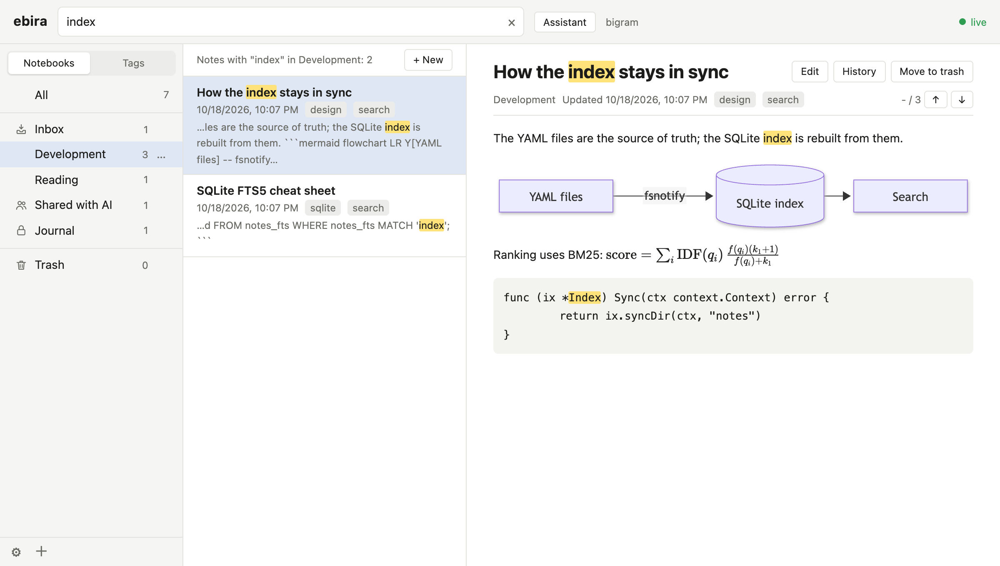
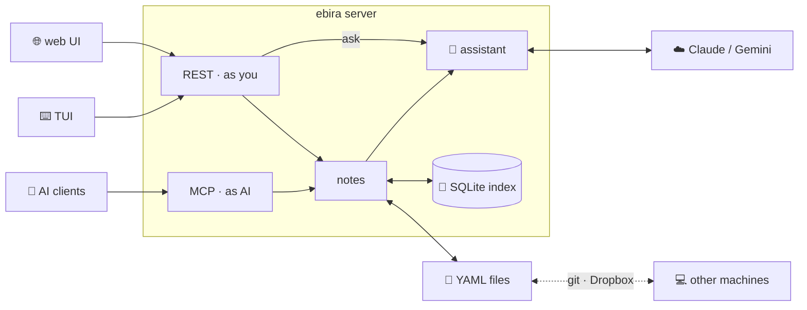
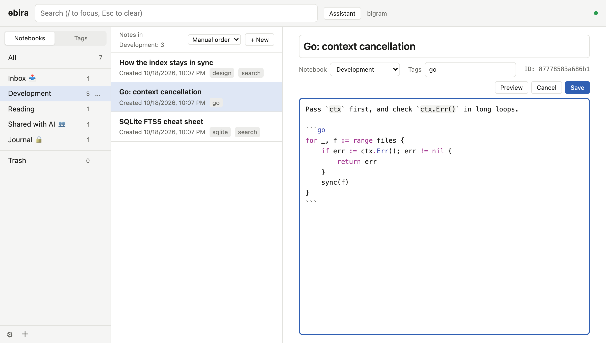
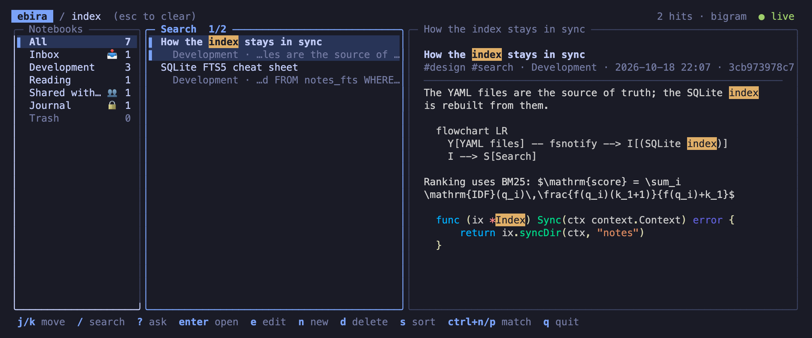

<p align="center">
  
</p>

<h1 align="center">ebira</h1>

<blockquote lang="ja">
  <p title="Yoichi took a humming-bulb arrow, set it to the string, drew it to the full and let it fly with a twang. Though he was a small man, the arrow was twelve hand-breadths and three fingers long and the bow was strong; the humming bulb sang out so long that it echoed across the bay, and without fail it struck the fan an inch or so from the rivet and cut it clean through. The arrow went into the sea, and the fan rose up into the sky. Tossed once, twice by the spring wind, it scattered down onto the sea.">与一鏑を取つてつがひ、よつぴいてひやうど放つ。小兵といふぢやう、十二束三伏、弓は強し、鏑は浦響くほどに長鳴りして、あやまたず扇の要際一寸ばかりを射て、ひふつとぞ射切つたる。鏑は海へ入りければ、扇は空へぞ上がりける。春風に一もみ二もみもまれて、海へさつとぞ散つたりける。</p>
  <p title="The fan, all crimson with a rising sun on it, drifted on the white waves in the glow of the setting sun, sinking and rising as it rocked. Out at sea the Heike beat on the sides of their boats in admiration; on the shore the Genji beat on their quivers, their ebira, and roared.">皆紅の扇の日出だしたるが、夕日の輝いたるに、白波の上にただよひ、浮きぬ沈みぬ揺られければ、沖には平家、舷を叩いて感じたり、陸には源氏、箙を叩いてどよめきけり。</p>
</blockquote>

<p align="center">
  <strong>Your notes as plain YAML files, synced with git if you like.<br>Searchable in Japanese and English, and shared with your AI on your terms.</strong>
</p>

<p align="center">
  
  <a href="LICENSE"></a>
  <a href="https://goa.design"></a>
  <a href="https://goa.design/docs/2-goa-ai/"></a>
</p>

<p align="center">
  English | <a href="README.ja.md">日本語</a>
</p>

---

ebira is a note app with a strong search. Every note is a YAML file in a folder you own: keep it as it is, put it in a synced folder such as Dropbox, or let ebira sync it with git. A local server keeps a SQLite index of the notes, and serves a web UI, a TUI, a REST API and an MCP server for AI clients.

<p align="center">
  
</p>

## Why

Plain files are the best home for notes: they outlive apps, and git gives you sync and history for free. But a folder of files is hard to search, especially in Japanese, where words are not separated by spaces. And when an AI can read your notes, you want to decide which ones.

- **Files you own** — one note, one YAML file. Edit them with any editor; ebira notices.
- **Search that understands Japanese** — morphological analysis finds the other forms of a word, and bigrams catch what it misses.
- **AI with boundaries** — each notebook says what an AI may do with it: read, write, only drop notes in, or nothing at all.



## Web UI and TUI

The same notes, from the browser or from the terminal; both talk to the same local server, and each shows the other's changes as they happen.

**Web UI** — `ebira web`. Notebooks and tags on the left, the notes in the middle, the note on the right; create, rename, retype and trash notebooks from their menus or by dragging them onto the trash, empty the trash from its menu, and drag notes onto a notebook to move them; edit Markdown with list continuation and code coloring, paste images, and see math and diagrams rendered.

<p align="center">
  
</p>

**TUI** — `ebira`. The same three panes in the terminal, driven by the keyboard: `/` to search, `j`/`k` to move, `z` to zoom the note to the whole width, `e` to edit in the TUI or in your `$EDITOR`.

<p align="center">
  
</p>

## Features

- **YAML notes in folders** — `<notebook>/<id>.yaml` in your notes directory. Comments and unknown keys survive every update. Images live next to their note.
- **Five search modes** — `bigram` (default), `trigram`, `ja` (Japanese morphological analysis with [kagome](https://github.com/ikawaha/kagome), plus bigrams), `en` (English words with their stems, plus trigrams), and `like`. Matches are highlighted in the list and the note.
- **Sync with Dropbox, iCloud Drive and the like** — keep the notes in a synced folder; the conflicted copies the services leave become notes, so no change is hidden.
- **Sync with git, if you like** — `ebira sync`, a menu item, or every few minutes: commit, merge and push in one step. A note changed on two machines never ends in conflict markers; the other version becomes a new note.
- **Always up to date** — the index follows file changes (fsnotify), so `git pull` or another editor just works. The index is a cache: delete it and it is rebuilt.
- **Web UI** — notebooks and tags, search as you type, Markdown with math (KaTeX) and diagrams (Mermaid), an editor with list continuation and code coloring (CodeMirror 6), drag and drop to reorder and to import, images by paste, and live updates. In English and Japanese, with light and dark themes.
- **TUI** — the same notes in the terminal.
- **MCP server** — AI clients such as Claude Code can list, search and read notes, and write where you allow it (see [MCP server](#mcp-server)).
- **Notebook kinds for AI** — `default` (AI reads), `collab` (AI reads and writes), `drop` (AI can only drop new notes in; the inbox by default), and `private` (invisible to AI).
- **Assistant** — ask questions about your notes in the web UI; it searches and reads them, and answers with links. Claude or Gemini.
- **Import** — Markdown files with their front matter and images.
- **Safe edits** — conflicts are detected with ETags; deleted notes go to the trash first.
- **Undo and history** — undo in the editor even after saving; undo moves, reordering and changes of notebooks from a bar or with Cmd+Z; and put back an earlier version of a note from its history, which ebira keeps on each machine (up to 50 versions per note, not synced).
- **One binary, no cgo**

## Installation

Requires Go 1.27 or later.

```bash
go install github.com/ikawaha/ebira/cmd/ebira@latest
```

ebira runs on macOS and Linux.

## Quick Start

1. **Start ebira.** The first time, it asks where to keep your notes, the git repository to sync them with (if any), how to search them and the language of the web UI and the TUI, and saves the answers to `~/.config/ebira/config.yaml`, with the address of the server (`localhost:13579`), so that the URL you give to MCP clients stays the same. To share the notes among machines, answer a folder synced by Dropbox or the like, such as `~/Dropbox/notes`, or give the same git repository on every machine (see [Sync with git](#sync-with-git) and [Sync with Dropbox, iCloud Drive and others](#sync-with-dropbox-icloud-drive-and-others)).

   ```console
   $ ebira web
   No notes found: no -notes, no notes_dir in ~/.config/ebira/config.yaml, and no notes/ in ~/work.
   Let's set up ebira.

   Directory to keep the notes in [~/notes]:
   ...
   ```

   `ebira web` starts the server in the background and opens the web UI at <http://localhost:13579/>. `ebira` opens the TUI instead. The server keeps running when you close them.

2. **Write notes**, in the web UI (`c` for a new note) or as files:

   ```yaml
   # ~/notes/inbox/weekend.yaml
   title: Ideas for the weekend
   tags: [todo]
   created_at: 2026-10-18T10:00:00+09:00
   updated_at: 2026-10-18T10:00:00+09:00
   body: |
     - Fix the bike
     - Try the new ramen place
   ```

3. **Bring your Markdown.**

   ```bash
   ebira import -notebook reading ~/Documents/notes
   ```

4. **Sync with git**, or skip this step: without git, the notes are just files, which a folder synced by Dropbox or the like can share. If you set up a repository, ebira syncs every 10 minutes, or whenever you run `ebira sync`. To start syncing notes you already have:

   ```bash
   ebira sync -remote git@github.com:you/notes.git   # once; an empty repository, or one with notes
   echo "git_sync: 10m" >> ~/.config/ebira/config.yaml
   ```

5. **Let your AI in**, as far as you like (see [MCP server](#mcp-server) for other clients). With Claude Code:

   ```bash
   claude mcp add --transport http ebira http://localhost:13579/mcp
   ```

## Commands

| Command | Description |
| --- | --- |
| `ebira [-lang en\|ja]` | Open the TUI, starting the server in the background if needed |
| `ebira web [-no-open]` | Open the web UI in the browser, starting the server in the background if needed |
| `ebira serve` | Run the server in the foreground |
| `ebira server start\|stop\|restart\|status` | Manage the server in the background; `restart` keeps the flags it ran with |
| `ebira import [-notebook ID] [-force] [-dry-run] path...` | Import Markdown files, and the images they refer to, as notes |
| `ebira files check [-delete]` | List unused images and broken image references |
| `ebira sync [-remote URL]` | Sync the notes with their git repository: commit, merge the upstream branch and push; `-remote` connects them to a repository first |
| `ebira auth passkey [-no-open]` | Register a passkey for the web UI, on a one-time URL (experimental; see [What it guards](#what-it-guards-and-what-it-does-not)) |
| `ebira auth reset [-yes]` | Remove every passkey and end every session, such as when the passkeys are lost |

Flags of `serve` (also taken by `server start` and `server restart`):

| Flag | Default | Description |
| --- | --- | --- |
| `-notes` | `notes_dir` of the settings file, else `./notes` | The notes directory |
| `-addr` | `addr` of the settings file, else `localhost:13579` | Address to listen on |
| `-search` | `search` of `_ebira.yaml` in the notes directory, else `bigram` | `like`, `bigram`, `trigram`, `en` or `ja` |
| `-watch` | `true` | Watch the notes and update the index |
| `-lang` | `lang` of the settings file, else the browser's | Language of the web UI: `en` or `ja` (the TUI takes `ebira -lang` or `lang` of the settings file, else `$LANG`) |
| `-provider`, `-model` | the provider whose API key is set | Model of the assistant: `anthropic` or `gemini` |
| `-git-sync` | `git_sync` of the settings file, else off | Sync with git at the start and at this interval, such as `10m` |
| `-auth` | `auth` of the settings file, else `none` | `none`, or `passkey` to treat only the web UI signed in with a passkey as you (experimental) |

Run any command with `-h` for all its flags.

## Your notes

```
~/notes/
├── _ebira.yaml              # settings shared with the notes, such as the search mode
├── inbox/
│   └── 3f9a1c0e7b2d4a.yaml
├── development/
│   ├── _notebook.yaml       # display name, order, kind and sort of the notebook
│   ├── 8c21d0f4a9e3b7.yaml
│   └── 8c21d0f4a9e3b7.assets/
│       └── diagram.png
└── trash/
```

Only the notes are in the notes directory: the index and the server's state, with the earlier versions of the notes, stay on each machine, in `~/.cache/ebira` and `~/.local/state/ebira`. The earlier versions are in `history/` there; old ones are dropped by themselves (see above), and you may delete the folder to drop them all, which leaves the notes as they are.

- A **notebook** is a folder. `inbox` and `trash` always exist; deleting a note moves it to the trash first.
- A **sub notebook** is a folder in a notebook, one level deep, such as `development/design/`. It takes the kind of its notebook. The web UI shows the sub notebooks at the top of the note list of their notebook; create one from the menu of the notebook, or move a notebook into another from its menu or by dropping it on the middle of the other one.
- A **note** has `title`, `tags`, `created_at`, `updated_at` and a Markdown `body`. ebira adds `order` when you reorder notes by hand and `created_by: ai` when an AI wrote the note.
- **Images** go in `<id>.assets/` next to the note, and the body refers to them as ``.

## Sync with git

git is optional. Without it, ebira works the same, and the notes are plain files that you can back up or sync any way you like; the web UI shows **Sync with git** only for notes in a repository.

`ebira sync`, **Sync with git** in the web UI's settings menu, and `-git-sync` all do the same, in the server:

1. Commit the changes of the notes directory (not `.DS_Store`), with the changed files in the message.
2. If the branch has an upstream branch, fetch it and merge it.
3. Push.

The repository is the notes directory itself (`~/notes`), as set up by ebira, or one above it that tracks it. The remote and the branch are those of git: ebira syncs with the upstream branch of the current branch, so change them with `git remote set-url` and `git branch --set-upstream-to`. ebira runs your `git`, so your credentials, SSH keys and Git LFS settings apply; it never asks for a password, so set up a credential helper or an SSH agent for syncing in the background.

A merge never stops in conflict. A note changed on both machines keeps this machine's version, and the other version becomes a new note next to it, titled like *Plan (conflict 2026-10-18 20:00)*: compare them and delete the one you do not need. Another file changed on both sides keeps this side's version, and a file deleted on one side and changed on the other keeps the changed one; the merge commit has the other versions. Writes of notes wait while git changes the files, and the index follows. If you merge by hand and leave conflict markers in a note, ebira reports the note and keeps showing its last good version.

## Sync with Dropbox, iCloud Drive and others

Put the notes directory in a folder that a file sync service syncs, such as Dropbox, iCloud Drive, OneDrive, Google Drive or Syncthing. ebira needs no settings for it. Only the notes are there: the index and the server's state stay on each machine.

1. **On the first machine**, answer a directory in the synced folder when ebira sets up, such as `~/Dropbox/notes`. Setup tells you that the folder is synced, and does not offer git.
2. **On the other machines**, wait until the service has synced the folder, then answer the same directory. ebira finds the notes and uses their settings, such as the search mode, and builds an index of them on that machine. The path may differ between machines; each saves its own `notes_dir`.

Starting the second machine before the folder is synced makes new, empty notes, whose settings then clash with the first machine's.

When a note is changed on two machines, the service keeps one version and leaves the other as a copy, such as `3f9a… (MacBook's conflicted copy 2026-10-18).yaml` or `3f9a… 2.yaml`. ebira makes such a copy into a new note next to it, titled like *Plan (conflict copy)*, or removes it when it is the same as the note. A note moved on one machine and changed on another keeps its ID where it was changed last, and the other one becomes a copy the same way. The new notes follow from the files alone, so two machines doing this at once make the same notes.

- Keep the folder on the disk, so that searches and the index do not wait for downloads: *Make available offline* for Dropbox, *Keep Downloaded* for iCloud Drive, *Always keep on this device* for OneDrive. With selective sync, include the folder on every machine.
- Do not use git in a synced folder: the services can break a repository, and a change synced from another machine would be committed again. Setup does not offer git there. Use one or the other.

## Search

| Mode | How | Good for |
| --- | --- | --- |
| `bigram` | Splits text into overlapping pairs of characters | Any language; finds any substring of two or more characters |
| `trigram` | Splits text into overlapping runs of three characters | Any language, with a smaller choice of matches for long terms; a term of one or two characters, such as many Japanese words, is searched through every note, more slowly |
| `ja` | Splits Japanese into words with kagome, with the verbs and adjectives in their base form, and also searches bigrams | Notes in Japanese: a search for a verb finds its other forms |
| `en` | Takes English words with their stems (the Snowball English stemmer), without stop words such as *the* and *of*, and Japanese as bigrams; also searches trigrams, for parts of words | Notes in English: *plan* finds *plans* and *planning*, and a word being typed is still found |
| `like` | SQL `LIKE` | Small collections |

Text is normalized with NFKC and lowercased, so full-width and half-width characters, and upper and lower case, match each other. Set the mode for all your machines in `_ebira.yaml` of the notes directory:

```yaml
search: ja
```

## MCP server

ebira serves your notes to AI clients, such as Claude Code, Cursor and Claude Desktop, over the [Model Context Protocol](https://modelcontextprotocol.io). An AI can search and read the notes you let it see, and write notes where you let it, so you can ask it to look something up in your notes, or to keep what it found in them.

### Connecting

The MCP server is part of the ebira server, at `http://localhost:13579/mcp` (Streamable HTTP; the address follows `-addr`). Keep the server running: `ebira web` and `ebira` start it in the background, and so does `ebira server start`.

Claude Code:

```bash
claude mcp add --transport http ebira http://localhost:13579/mcp
```

Cursor (`~/.cursor/mcp.json`) and other clients that take a URL:

```json
{
  "mcpServers": {
    "ebira": { "url": "http://localhost:13579/mcp" }
  }
}
```

Claude Desktop (`claude_desktop_config.json`), which starts servers as commands, through [mcp-remote](https://www.npmjs.com/package/mcp-remote):

```json
{
  "mcpServers": {
    "ebira": { "command": "npx", "args": ["mcp-remote", "http://localhost:13579/mcp"] }
  }
}
```

### Tools

| Tool | What it does |
| --- | --- |
| `list_notebooks` | List the notebooks, with their kinds and note counts |
| `list_notes` | List the notes of a notebook or a tag, in pages |
| `list_tags` | List the tags, with their note counts |
| `search_notes` | Search the notes, in Japanese or English; the results come with snippets |
| `get_note` | Get a note, with its body and its version |
| `create_ai_note` | Write a new note in a `collab` notebook, or drop one in a `drop` notebook |
| `import_ai_note` | Import a Markdown file, with its front matter, as a new note, the same way |
| `update_ai_note` | Change a note in a `collab` notebook; needs the version from `get_note` |
| `delete_ai_note` | Move a note in a `collab` notebook to the trash; needs the version from `get_note` |
| `move_ai_note` | Reorder a note in a `collab` notebook: put it after another note, or first |
| `create_ai_notebook` | Make a new `collab` notebook, for the AI to write in |
| `make_notebook_private` | Hide a notebook from AI; only you can undo it |

The version makes an AI's changes safe: when a note has changed since the AI read it, the change is refused, and nothing you wrote is overwritten.

### What AI may do

Each notebook has a kind, which you set in the web UI or the TUI:

| Kind | AI can read | AI can write |
| --- | --- | --- |
| `default` | ✅ | — |
| `collab` | ✅ | ✅ create, update, move to the trash |
| `drop` | — (only its name) | only new notes, with IDs ebira chooses |
| `private` | — (not even its name) | — |

The inbox is `drop` unless you change it, and the trash is invisible to AI. Notes an AI writes are marked with `created_by: ai`, and shown with ✨ in the web UI and ✦ in the TUI.

### Asking

Once connected, ask in your own words, for example:

- "Search my ebira notes for what I wrote about SQLite indexes, and summarize it."
- "Read my notes tagged travel and make a packing list."
- "Write what we found today as a note in my *Shared with AI* notebook."
- "Drop a reminder to renew my passport in my inbox."

### What it guards, and what it does not

- There is no login by default: the server answers only requests to localhost (and the host of `-addr`), and refuses requests that change notes from web pages of other sites. Keep it on your machine.
- Every request to the REST API is taken as from you, so an AI agent on your machine that can run `curl` could act as you. To stop that, require a passkey (experimental): run `ebira auth passkey` to register one on a one-time URL, then set `auth: passkey` in the settings file and restart the server. The web UI then asks you to sign in with the passkey, and REST requests without the sign-in are refused. MCP stays as it is. The TUI signs in through the web UI: it shows a URL and a code, and you approve the code in the web UI signed in with the passkey (press `o` to open the URL). The commands that call the server, such as `ebira sync`, sign in the same way. Important operations, such as making a private notebook visible to AI, reading the history of a note or emptying the trash, ask for the passkey again unless you signed in within 5 minutes. Manage the passkeys, and end the other sessions, from **Manage passkeys…** in the settings menu; if you lose them, `ebira auth reset` removes every passkey.
- The kinds hold for every AI that goes through ebira's API, MCP and the assistant alike. They cannot stop a program on your machine that reads the note files directly, such as an AI agent with file access; `private` marks what AI is not to see, and is not encryption.

## Assistant

The assistant answers questions about your notes inside ebira: open it with the Assistant button of the web UI (or `?` in the TUI, or `POST /ask`). It searches and reads notes through the same rules as MCP, and answers with links to the notes it used. It needs `ANTHROPIC_API_KEY` (Claude), or `GEMINI_API_KEY` or `GOOGLE_API_KEY` (Gemini), set for the server; pass the key when you start it, for example from a password manager:

```bash
op run --env-file=.env -- ebira server restart
```

## Settings

`~/.config/ebira/config.yaml` holds the settings of this machine. Each key is the default of a flag:

```yaml
notes_dir: ~/notes
addr: localhost:13579
lang: en
```

The keys are `notes_dir`, `addr`, `watch`, `provider`, `model`, `lang`, `theme` (`auto`, `light` or `dark`; the web UI's settings menu can choose another, and `light` makes the TUI use its light colors) `git_sync` and `auth` (`none` or `passkey`). API keys never go in it. The index is kept in `~/.cache/ebira`, and the server's state and log in `~/.local/state/ebira` (the XDG variables are honored).

## License

[AGPL-3.0-or-later](LICENSE)

---

<sub>The icon is a detail of <i>Fujiwara no Hidesato Shooting the Giant Centipede at the Dragon King's Palace</i> (1890) by Tsukioka Yoshitoshi, in the public domain (<a href="https://commons.wikimedia.org/wiki/File:Yoshitoshi_Fujiwara_no_Hidesato.jpg">Wikimedia Commons</a>).</sub>
