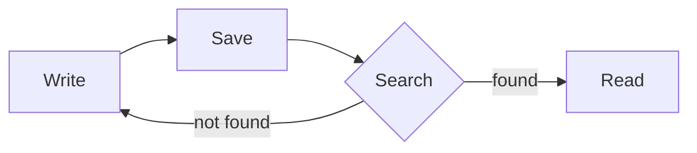
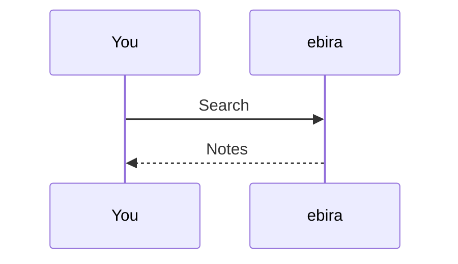

## Math

Inline math goes between `$...$`: $E = mc^2$

Display math goes between `$$`, or in a `math` code block.

$$
\int_0^\infty e^{-x^2}\,dx = \frac{\sqrt{\pi}}{2}
$$

```math
\sum_{k=1}^{n} k = \frac{n(n+1)}{2}
```

A price like `$5` stays text, as when a digit follows the closing `$`.

## Diagrams

A `mermaid` code block becomes a diagram.





A mistake shows in red, with the text as written.
