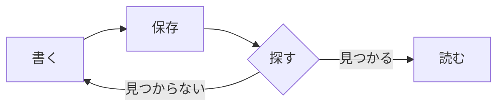
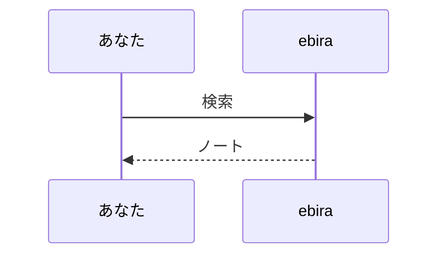

## 数式

文の中の数式は `$...$` で囲みます: $E = mc^2$

独立した数式は `$$` で囲むか、`math` のコードブロックに書きます。

$$
\int_0^\infty e^{-x^2}\,dx = \frac{\sqrt{\pi}}{2}
$$

```math
\sum_{k=1}^{n} k = \frac{n(n+1)}{2}
```

値段のような `$5` は数式になりません（閉じる `$` のすぐ後ろが数字のときなど）。

## 図

`mermaid` のコードブロックに書くと、図になります。





書き方を誤ると、元の文字と一緒に誤りを赤く出します。
